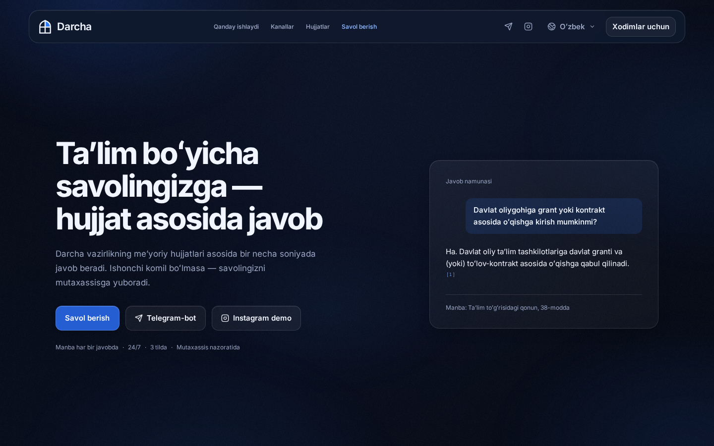
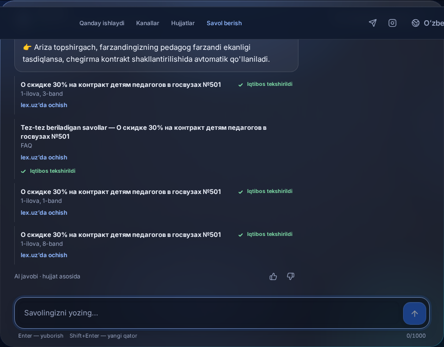
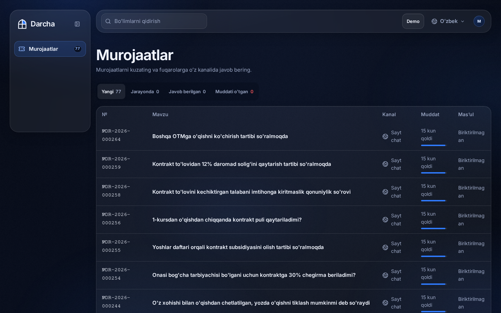
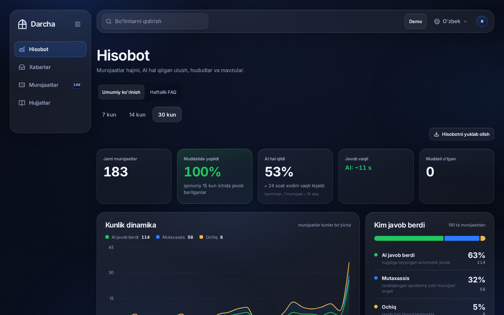

# Darcha

**Live demo: https://81-26-189-83.sslip.io** · staff panel: [/login](https://81-26-189-83.sslip.io/login) (one-click demo roles) · API docs: [/docs](https://81-26-189-83.sslip.io/docs)

> **Qisqacha (oʻzbekcha).** Darcha — Oliy taʼlim, fan va innovatsiyalar vazirligiga fuqarolar murojaatlariga
> rasmiy meʼyoriy hujjatlar asosida javob beradigan AI platforma. Telegram-bot, sayt chati va Instagram bitta
> quvurdan oʻtadi. Oddiy savollarga bir necha soniyada **lex.uz havolasi bilan** javob beriladi; ishonch past
> boʻlsa yoki holat shaxsiy boʻlsa — murojaat mutaxassisga qoralama yoki 15 kunlik qonuniy muddatli tiket sifatida
> yuboriladi. Rahbariyat uchun tahlil va haftalik FAQ hisobot. 44 ta hujjat, 3 638 boʻlak; huquqni top-4 ichida
> topish — 96,7%, zararli xabarlarga AI avtomatik javobi — 0/33.

Darcha is one AI core for citizen inquiries to the Ministry of Education of Uzbekistan
(National AI Hackathon, Tashkent, education track, problem #1). Every message, whether it comes from the Telegram bot,
the website chat or Instagram, goes through the same pipeline. Typical questions get an answer in seconds that
**cites the exact article of the regulation on lex.uz**. When the system is not sure, or the case is personal,
sensitive or harmful, the AI does not answer on its own: the inquiry becomes a draft for a staff member or a ticket
with the legal 15-day deadline. Everything feeds the leadership dashboard and a weekly FAQ report.

| Landing | Chat answer with verified citations |
|---|---|
|  |  |
| **Staff panel: tickets** | **Leadership analytics** |
|  |  |

## Features

- **3 channels, one pipeline**
  - **Telegram bot**: direct messages, comments under channel posts, and questions in groups (answers question-like
    messages or @mentions). Replies are formatted with clickable sources.
  - **Website chat**: the public landing page with chat, region choice and suggested questions.
  - **Instagram sandbox**: comments, Direct and tags in a mock profile (`/demo/instagram`). A real Meta webhook
    adapter is included as well.
- **4 answer levels**
  - 🟢 **green**: the AI answers automatically with citations from the knowledge base.
  - ⚪ **gray**: a fixed, polite reply sent automatically: gratitude, off-topic, and firm refusals for personal-data
    requests, cheating, forgery, defamation, threats and insults.
  - 🟡 **yellow**: a draft that a staff member approves before it is sent; the citizen gets a "being prepared" note.
  - 🔴 **red**: a ticket with a number (`DR-2026-000123`) and a deadline of **15 days** under the law on appeals
    (5 days for urgent cases). Fraud and violence also trigger an alert.
- **Staff panel with roles**: operator (inbox and drafts), specialist (tickets of their department), manager
  (analytics), knowledge-base admin. Each role has a one-click demo login.
- **Leadership analytics**: volume over 7/14/30 days, who answered (AI or specialist), share closed on time, regions,
  topics and spikes. The **weekly FAQ report** clusters the questions to show what people ask most.

## Architecture

```
Telegram ─┐
Website  ─┼─► one pipeline for every channel
Instagram ┘
  1 normalize      language + script detection, Cyrillic → Latin, PII masking (PINFL, passport, phone, card)
  2 classify       LLM, strict JSON: type, topic, region, sentiment, urgency, safety flags
  3 search         bge-m3 vectors top-8 + Postgres full-text top-8 → Reciprocal Rank Fusion → bge-reranker → top-4
  4 answer         LLM writes ONLY from the retrieved pieces, citing each one by id
  5 verify in code every citation must point to a retrieved, active, non-expired document;
                   confidence = LLM confidence × retrieval support (capped when citations are missing)
  6 route          green / gray / yellow / red (rules in backend/app/pipeline/route.py, unit-tested)
  7 deliver        reply in the same channel, store everything for the panel and analytics
PostgreSQL 17 + pgvector (HNSW) · background jobs: SLA reminders, spike alerts, weekly FAQ report
```

The model never sees raw personal data. The LLM is called from exactly one place,
`backend/app/llm/client.py`. It currently supports Anthropic Claude, Google Gemini and OpenRouter (pinned
provider, JSON validation, retry on rate limits), and is switched with `LLM_PROVIDER` in `.env`.

## Knowledge base

- **44 documents and 3 638 searchable pieces**, mostly full official texts fetched from **lex.uz**:
  laws, Cabinet resolutions, ministry orders, the Labour Code and official FAQ pages.
- **Chunking follows the legal structure** (appendix → chapter → article/point), so citations read
  "3-ilova, 14-band". Tables (position lists, scoring tables) are kept as rows.
- **Repealed acts are never cited.** The fetcher reads lex.uz's own repeal notice. Repealed acts stay on a
  stop-list (for example ПКМ 393), and replacements are linked (reg. 1950 → reg. 2321).
- **Partly repealed acts stay active** with the restriction in their title. For example, in ПКМ 344 point 4 and
  appendix 2 were cancelled by ПКМ 578. Time-limited decisions stop being cited after their `valid_until` date.
- Researchers keep the master list in a spreadsheet. `scripts/import_findings.py` turns it into
  `data/registry.yaml`; `scripts/fetch_lex.py` downloads the texts and checks their status;
  `scripts/ingest_docs.py` indexes them.

## Evaluation

`scripts/run_eval.py data/eval/questions.jsonl` runs the live system end to end: 148 questions (100 synthetic and
48 real citizen questions in Uzbek Latin, Uzbek Cyrillic and Russian) plus 33 harmful messages.

| Metric | Result |
|---|---|
| Correct law in the top 4 retrieved pieces | **96.7%** (117/121) |
| Harmful messages auto-answered by the AI | **0 / 33** (18 polite fixed refusals, 9 tickets, 5 drafts, 1 ignored as spam) |
| Questions that need a human kept from auto-answer | **88.5%** (23/26). The 3 misses are labour-law questions that the newly added Labour Code now answers with citations. |
| Strict answer accuracy (all key points + right citation + sent automatically) | **55%** (52/95) |

The strict score counts every answer that went to a human as a miss. Wrong answers do not reach citizens on their
own: they become drafts or tickets.

## Tech stack

- **Backend**: Python 3.12, FastAPI, SQLAlchemy 2 (async), PostgreSQL 17 + pgvector, aiogram 3, Meta Graph API
  webhooks, JWT auth.
- **Retrieval**: BAAI/bge-m3 embeddings, BAAI/bge-reranker-v2-m3 (fp16 on GPU), Postgres full-text, RRF.
- **LLM**: provider-agnostic client (Claude / Gemini / OpenRouter); structured JSON output.
- **Frontend**: React 18, TypeScript (strict), Vite, Tailwind CSS v4, Radix primitives, TanStack Query, Recharts,
  Motion; UI in Uzbek Latin, Uzbek Cyrillic and Russian.
- **Tooling**: pytest, ruff, ESLint, GitHub Actions.

## How to run

```bash
cp .env.example .env               # fill in an LLM key (LLM_PROVIDER + its key), TELEGRAM_BOT_TOKEN, JWT_SECRET
docker compose up -d db            # PostgreSQL 17 + pgvector

# backend
cd backend && uv venv -p 3.12 && uv pip install -r pyproject.toml --extra dev && cd ..
backend/.venv/bin/python scripts/ingest_docs.py data/documents        # index the knowledge base (GPU recommended)
backend/.venv/bin/python scripts/seed_demo_history.py                 # optional: 150 marked demo appeals for analytics
cd backend && .venv/bin/uvicorn app.main:app --host 0.0.0.0 --port 8000

# frontend (another terminal)
cd frontend && cp .env.example .env.local     # VITE_API_URL=http://localhost:8000 (empty = built-in mock data)
npm install && npm run dev -- --port 5180
```

- **API docs**: Swagger at http://localhost:8000/docs. Everything in Docker (CPU only): `docker compose up -d`.
- **Checks**: `cd backend && .venv/bin/pytest -q` · `cd frontend && npm run build && npm run lint`.
- **Evaluation**: `backend/.venv/bin/python scripts/run_eval.py data/eval/questions.jsonl`.
- **Telegram**: polling works without a public URL. Set `TELEGRAM_GROUP_MODE=mention` to answer only @mentions
  in groups.

## Deploy (single VM)

The live demo runs on one Ubuntu 24.04 VM (4 vCPU, 8 GB RAM, CPU only) with `docker-compose.prod.yml`:
`db` (PostgreSQL 17 + pgvector, not exposed), `api` (FastAPI, bge-m3 on CPU, model cache in a volume) and `web`
(Caddy: the built React app with SPA fallback, reverse proxy for `/api/*`, `/health`, `/docs`, `/openapi.json`,
`/webhooks/*`, automatic HTTPS). Every service has `restart: unless-stopped`.

```bash
git clone https://github.com/netranamix2/darcha_ai && cd darcha_ai
cp .env.example .env && chmod 600 .env
# set: JWT_SECRET, LLM_PROVIDER + key, DEVICE=cpu, USE_RERANKER=0, TELEGRAM_MODE=off|webhook,
#      SITE_ADDRESS=<host>, CORS_ORIGINS=https://<host>, PUBLIC_BASE_URL=https://<host>, VITE_API_URL=https://<host>
docker compose -f docker-compose.prod.yml up -d --build
docker compose -f docker-compose.prod.yml run --rm api python scripts/ingest_docs.py /data/documents
docker compose -f docker-compose.prod.yml run --rm api python scripts/seed_demo_history.py   # optional demo analytics
```

`<host>` can be `<ip-with-dashes>.sslip.io` when there is no domain; Caddy gets a Let's Encrypt certificate for it.

## Demo accounts

These are public seed accounts for the demo only. The `/login` page also has one-click role cards.

| Role | Username | Password |
|---|---|---|
| Operator | `operator` | `operator123` |
| Specialist (higher education) | `specialist` | `specialist123` |
| Specialist (teacher attestation) | `teachers` | `teachers123` |
| Manager | `manager` | `manager123` |
| Knowledge-base admin | `kbadmin` | `kbadmin123` |

## Honest notes

- **Instagram is a sandbox** until the Meta app passes App Review. The webhook adapter is implemented; the demo
  profile is clearly marked as a demo and does not use the ministry's name or emblem.
- **The LLM is swappable**: `backend/app/llm/client.py` is the only file that talks to a model. The evaluation above
  ran on `z-ai/glm-5.3-flash` via OpenRouter.
- **Not an official ministry service.** It is a hackathon prototype, and answers cite the official texts on lex.uz.
- **Demo data is marked.** The analytics history from `seed_demo_history.py` is synthetic and labelled
  (`channel=demo`); `--remove` deletes it. Real citizen comments used for research are kept out of the repository.

## Team

- **Developer**: backend, AI pipeline, frontend integration.
- **Business analyst**: problem framing, process and metrics, pitch.
- **Two researchers**: the legal knowledge base (lex.uz acts, statuses, repeal checks), the test set and the
  harmful-message set.
